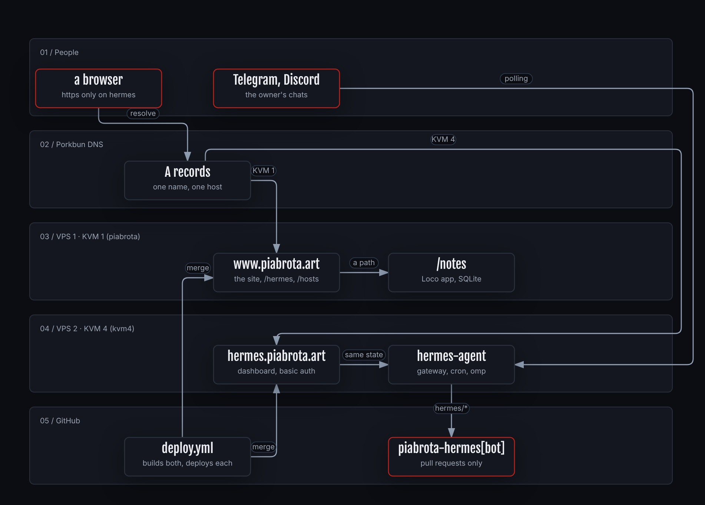
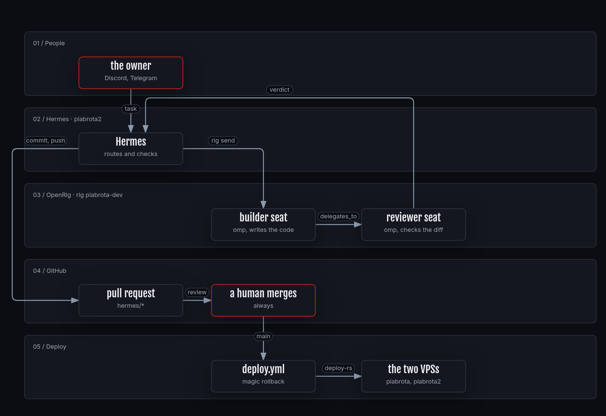
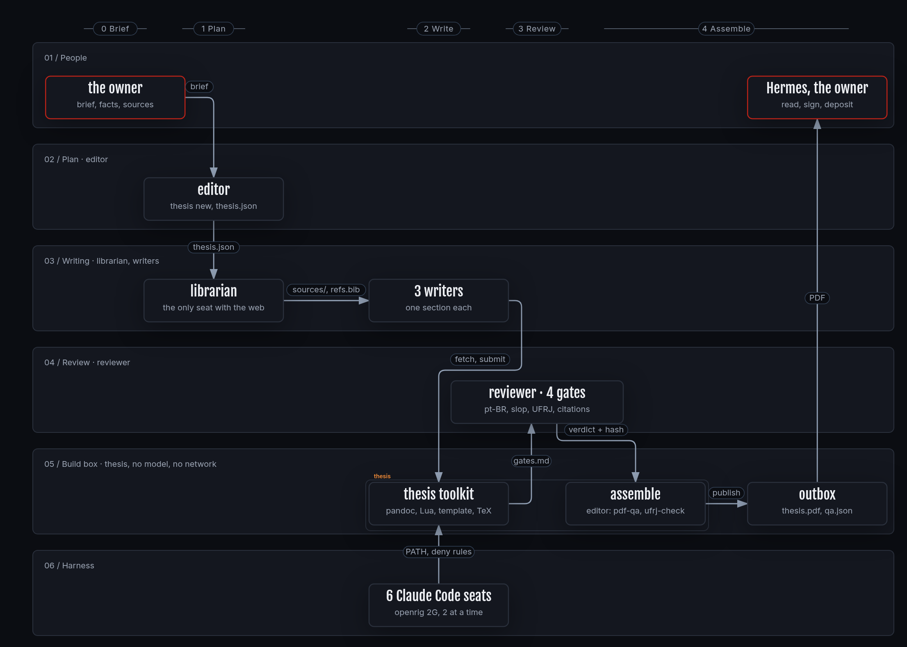
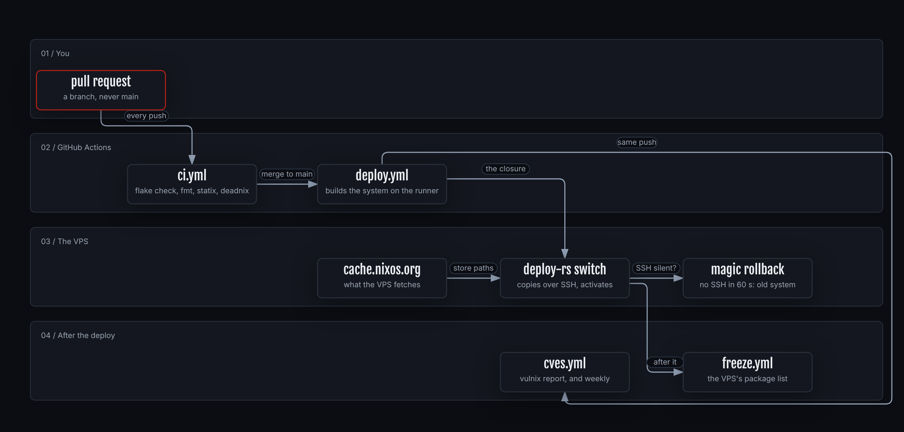
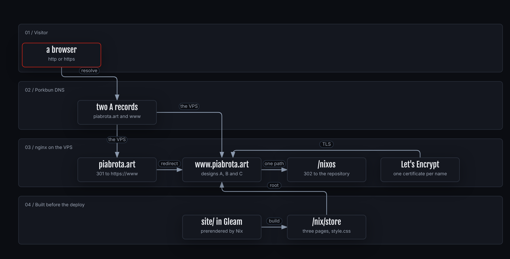

<div align="center">


# nix-os

<sub>无 · <i>mu</i> · the piabrota VPSs · <a href="#contents">contents</a> · <a href="#every-piabrotaart-address">addresses</a> · <a href="#configuration">configuration</a> · <a href="#reproduce-it">reproduce</a> · <a href="docs/DEPLOY.md">deploy</a> · <a href="docs/STRUCTURE.md">structure</a> · <a href="#related-repositories">related</a> · <a href="#license">license</a></sub>

[](https://github.com/piabrota/nix-os/actions/workflows/ci.yml)
[](https://github.com/piabrota/nix-os/actions/workflows/deploy.yml)
[](docs/STRUCTURE.md#what-it-pins)
[](#license)
[](https://deepwiki.com/piabrota/nix-os)
[](docs/HERMES.md)
[](https://www.piabrota.art/hosts)

</div>

> The NixOS configuration of two live Hostinger VPSs, and of three web tools on one of them: the Hermes dashboard, the OpenRig UI and the metrics page.

One flake, one system per host. **KVM 1** (`piabrota`, 1 vCPU, 4 GB) serves the public web at [piabrota.art](https://piabrota.art). **KVM 4** (`piabrota2`, 4 vCPU, 16 GB) runs [Hermes Agent](https://github.com/NousResearch/hermes-agent) and [OpenRig](https://github.com/mvschwarz/openrig). Every change is a pull request: a merge to `main` builds both systems on GitHub and deploys each one with [deploy-rs](https://github.com/serokell/deploy-rs), and a host rolls back by itself if SSH stops answering.

## Contents

- [Every piabrota.art address](#every-piabrotaart-address)
- [Configuration](#configuration)
  - [hermes.piabrota.art](#hermespiabrotaart)
  - [rig.piabrota.art](#rigpiabrotaart)
  - [metrics.piabrota.art](#metricspiabrotaart)
- [Reproduce it](#reproduce-it)
- [How it works](#how-it-works)
- [Documentation](#documentation)
- [Related repositories](#related-repositories)
- [Credits](#credits)
- [License](#license)

## Every piabrota.art address

The status is that of the first request on 2026-11-05 (`metrics` and `room` on 2026-11-06); no redirect is followed.

| Address | What it is | Host | Access | Source |
|---|---|---|---|---|
| [`hermes.piabrota.art`](https://hermes.piabrota.art/) | The Hermes dashboard. 401 without the login | KVM 4 | basic auth | `hermes-web.nix`, [`docs/HERMES.md`](docs/HERMES.md) |
| [`rig.piabrota.art`](https://rig.piabrota.art/) | The OpenRig web UI. 401 without the login. Its terminal can type into the seats | KVM 4 | basic auth, the dashboard's login file | `openrig.nix`, [`docs/OPENRIG.md`](docs/OPENRIG.md) |
| [`metrics.piabrota.art`](https://metrics.piabrota.art/) | CPU, memory, disk, top processes and running services of both hosts, and what each one runs (apps, sites, rigs, skills, plugins, MCP servers). Public, with `robots.txt` and bot blocks | KVM 4 | public | `metrics.nix`, [`docs/METRICS.md`](docs/METRICS.md) |
| [`piabrota.art`](https://piabrota.art) | 301 to `https://www.piabrota.art/`, same path | KVM 1 | public | `site.nix` |
| [`www.piabrota.art`](https://www.piabrota.art/) | The site, with `/hermes/` (Hermes's configuration as plain YAML, no secret), [`/figures/`](https://www.piabrota.art/figures/), [`/llms.txt`](https://www.piabrota.art/llms.txt) (an index for AI agents, from `mockups/data.nix`), `/notes` (one password) and `/nixos` (302 to this repository). `/skills/` answers 301 to `skills.piabrota.art` | KVM 1 | public | `site.nix`, `apps/notes/`, `figures-site/` |
| [`skills.piabrota.art`](https://skills.piabrota.art/) | The skills website, from [piabrota/skills](https://github.com/piabrota/skills) at a pinned commit. `www.piabrota.art/skills/` redirects to it. Not yet answering: its DNS record comes first | KVM 1 | public | `site.nix`, `skills-site/` |
| [`room.piabrota.art`](https://room.piabrota.art/) | The 3D room, [piabrota/room](https://github.com/piabrota/room) at a pinned commit, with its radio | KVM 4 | public | `room.nix`, `room-site/` |
| [`grid.piabrota.art`](https://grid.piabrota.art/) | The same room, opened on its ▲ grid view: the Brazilian coast on triangles. Not yet answering: its DNS record comes first | KVM 4 | public | `room.nix` (`piabrota.room.grid`) |
| [`proof.piabrota.art`](https://proof.piabrota.art/) | Every HTML page of [h0ffmann/proof](https://github.com/h0ffmann/proof) at a pinned commit, with an index. The archify pages open dark. Not yet answering: its DNS record comes first | KVM 4 | public | `proof.nix`, `proof-site/` |
| [`pirsig.piabrota.art`](https://pirsig.piabrota.art/) | The video notes and the archify figures of [piabrota/pirsig](https://github.com/piabrota/pirsig) at a pinned commit, with an index. The figures open dark. Not yet answering: its DNS record comes first | KVM 4 | public | `proof.nix`, `proof-site/` |
| `paperclip.piabrota.art` | Paperclip. Off since 2026-11-04: no answer | KVM 4 | none while off | `paperclip.nix`, [`docs/PAPERCLIP.md`](docs/PAPERCLIP.md) |

## Configuration

The Hermes dashboard and the OpenRig UI share one login: the file `/var/lib/hermes-web-secrets/htpasswd` on KVM 4, one `name:bcrypt-hash` line for each user. It is never in the repository. The metrics page is public (it holds no secret). Each vhost has TLS from Let's Encrypt, and the dashboard and the OpenRig UI have HTTP basic auth. Each service listens on 127.0.0.1 only. Every vhost answers `/favicon.ico` with the eye of the org ([`favicon.nix`](favicon.nix)). All options are off by default and `hosts/piabrota2/default.nix` turns them on.

### hermes.piabrota.art

Hermes's web dashboard, the unit `hermes-backend`, next to the gateway `hermes-agent` ([`hermes.nix`](hermes.nix)).

| Option | Value here | Meaning |
|---|---|---|
| `piabrota.hermesWeb.enable` | `true` | The dashboard behind nginx, TLS and basic auth. |
| `piabrota.hermesWeb.domain` | `hermes.piabrota.art` | The name nginx serves. Its A record must point at KVM 4. |
| `piabrota.hermesWeb.htpasswdFile` | `/var/lib/hermes-web-secrets/htpasswd` | The login file. Without it every request is a 500. |

The unit listens on `127.0.0.1:9119` and has `MemoryMax=2G`. nginx refuses `/api/env/reveal`, `/api/audio/voice-config` and writes to `/api/env`, so no secret reaches the browser; `checks.hermes-docs-url` fails if a Hermes bump renames one of them. Hermes is pinned to a release tag in `flake.nix`. More: [`docs/HERMES.md`](docs/HERMES.md), "The web dashboard".

### rig.piabrota.art

The web UI of OpenRig, the engine of the software factory, served by the unit `openrig` ([`openrig.nix`](openrig.nix)).

| Option | Value here | Meaning |
|---|---|---|
| `piabrota.openrig.enable` | `true` | The daemon, in the foreground, on loopback. |
| `piabrota.openrig.port` | `7433` | The daemon's loopback port. |
| `piabrota.openrig.web.enable` | `true` | The UI behind nginx, TLS and basic auth. |
| `piabrota.openrig.web.domain` | `rig.piabrota.art` | The name nginx serves. |
| `piabrota.openrig.web.htpasswdFile` | the dashboard's file | The same login as Hermes. |

`MemoryMax=2G` is one budget for the daemon, tmux and every seat. A restart of the unit ends every seat. The UI's terminal can type into a seat, so the login is the gate. More: [`docs/OPENRIG.md`](docs/OPENRIG.md), "The web UI".

### metrics.piabrota.art

A page with processes, memory and vCPU of both hosts, and a count of what each generation runs (Loco apps, sites, rigs, skills, plugins, MCP servers, packages, timers), made by Nix at build time. No agent and no database: a timer runs `metrics/collect.sh` (sh and awk) on each host, and one static page reads the files ([`metrics.nix`](metrics.nix), [`metrics/`](metrics/)).

| Option | Value here | Meaning |
|---|---|---|
| `piabrota.metrics.name`, `.label` | `piabrota2`, `piabrota2 (KVM 4)` | How the host appears on the page. Set on both hosts. |
| `piabrota.metrics.collector.enable`, `.interval` | `true`, `10` | The collector timer, in seconds. The page marks a host offline after 30 s. |
| `piabrota.metrics.web.enable`, `.domain` | `true`, `metrics.piabrota.art` | The page behind nginx and TLS, public, with `robots.txt` and bot blocks. `.htpasswdFile` (default `null`) puts a login back. KVM 4 only. |
| `piabrota.metrics.pull.enable`, `.url` | `true`, `https://www.piabrota.art/_metrics/piabrota.json` | KVM 4 fetches the file of KVM 1. |
| `piabrota.metrics.publish.enable`, `.allowFrom` | `true`, KVM 4's address | On KVM 1: one location serves its file to that address only. |

More: [`docs/METRICS.md`](docs/METRICS.md). `just metrics-test` runs the tests; `just metrics-preview` shows the page on fixtures.

## Reproduce it

You need Nix with flakes, a GitHub account and one or two Hostinger KVM VPSs with the NixOS template.

1. Fork the repository, then follow [`docs/FORK.md`](docs/FORK.md): the deploy key, three secrets and the first deploy. [`docs/FORK.ptBR.md`](docs/FORK.ptBR.md) is the same in Portuguese.
2. Build a host on your machine, without deploying:

   ```console
   just build piabrota2       # or: nix build .#nixosConfigurations.piabrota2.config.system.build.toplevel
   just check                 # what CI runs: nix flake check, nixpkgs-fmt, statix, deadnix, shellcheck
   ```

3. Point three A records (`hermes`, `rig`, `metrics`) at KVM 4 before the deploy, or the ACME order fails.
4. On KVM 4, make the login file with the command of [`docs/HERMES.md`](docs/HERMES.md), "The web dashboard", step 2. The Hermes secrets go in a root-only file in `/var/lib/hermes-secrets/` ([`docs/HERMES.md`](docs/HERMES.md), "One-time setup on the box").
5. Merge to `main`. [`docs/DEPLOY.md`](docs/DEPLOY.md) has the details of the deploy and the rollback.
6. Check the boxes: `just remote-hermes-check` and `just remote-health` (set `DEPLOY_HOST=<address>`). `just remote-restart` restarts their services by hand.

## How it works

Two hosts: a visitor's browser asks DNS, `www` goes to KVM 1 and `hermes`, `rig` and `metrics` go to KVM 4. There, the dashboard shares state with the gateway, and the gateway drives the unit `openrig`.

[](https://www.piabrota.art/figures/two-hosts/)

<details>
<summary>More figures</summary>

| | |
|---|---|
| [](https://www.piabrota.art/figures/software-factory/) | [](https://www.piabrota.art/figures/thesis-rig/) |
| [](https://www.piabrota.art/figures/how-nix-os-works/) | [](https://www.piabrota.art/figures/piabrota-art/) |

How to read each figure, and what it leaves out: [`docs/FIGURES.md`](docs/FIGURES.md).

</details>

## Documentation

| Page | What is in it |
|---|---|
| [`docs/HERMES.md`](docs/HERMES.md), [`pt-BR`](docs/HERMES.ptBR.md) | Hermes here: setup, secrets, the dashboard, checks, updating. |
| [`docs/OPENRIG.md`](docs/OPENRIG.md) | OpenRig, the software factory, the UI, the status and the guardrails. |
| [`docs/METRICS.md`](docs/METRICS.md), [`pt-BR`](docs/METRICS.ptBR.md) | The metrics page: collector, page, tests, cadence. |
| [`docs/DEPLOY.md`](docs/DEPLOY.md) | How a merge reaches the VPSs, and the one-time setup. |
| [`docs/FORK.md`](docs/FORK.md), [`pt-BR`](docs/FORK.ptBR.md) | Run your own VPS from a fork. |
| [`docs/STRUCTURE.md`](docs/STRUCTURE.md) | The pins, the file tree, the flake outputs and every `just` recipe. |
| [`docs/FIGURES.md`](docs/FIGURES.md) | The figures, how to read them, and the software factory status. |
| [`docs/PGX.md`](docs/PGX.md), [`docs/LOCO.md`](docs/LOCO.md), [`docs/SITE.md`](docs/SITE.md), [`docs/PAPERCLIP.md`](docs/PAPERCLIP.md), [`docs/THESIS.md`](docs/THESIS.md) | PGX, Loco apps, the static site, Paperclip (off) and the thesis rig. |
| [`AGENTS.md`](AGENTS.md) | The rules for AI agents that work here, and the resource budget. |

## Related repositories

Stars and commits on 2026-11-07.

| Project | Description | ⭐ Stars | Last commit | Commits in 2026 |
|---|---|---:|---|---:|
| [piabrota/room](https://github.com/piabrota/room) | A personal site that is a 3D room: switch camera shots, play VHS tapes, listen to lofi radio. Served here at room.piabrota.art. | 1 | 2026-11-07 | 49 |
| [h0ffmann/chaceon](https://github.com/h0ffmann/chaceon) | CPU and GPU wave modeling in pure agentic Rust. | 0 | 2026-11-04 | 108 |
| [marola-dev/marola](https://github.com/marola-dev/marola) | The umbrella of the [marola-dev](https://github.com/marola-dev) software fabric: a friendly guide to the sea near you, with water quality first. Site at [marola.dev](https://marola.dev). | 19 | 2026-10-29 | 604 |

## Credits

- The README layout follows [h0ffmann/awesome-neurosymbolic-ai](https://github.com/h0ffmann/awesome-neurosymbolic-ai), and before it [picasso](https://github.com/h0ffmann/picasso), which took it from [gvolpe/nix-config](https://github.com/gvolpe/nix-config). Several tools in `tools.nix` come from gvolpe's list.
- The drawing is made the way [pirsig](https://github.com/h0ffmann/pirsig)'s 無 is: `drawings/pen.nix` is pirsig's pen, ported from Rust to Nix (MPL-2.0, by the same author). See [docs/drawings](docs/drawings/README.md).
- The stroke order of 无 follows [KanjiVG](https://kanjivg.tagaini.net/) (© Ulrich Apel, CC BY-SA 3.0), used as a reference only.

## License

| What | License |
|---|---|
| Everything in this repository, the drawing included | [MPL-2.0](LICENSE) |
| `drawings/pen.nix` | MPL-2.0, ported from [h0ffmann/pirsig](https://github.com/h0ffmann/pirsig)'s Rust pen at `450e4da` |
| `.claude/skills/*/` | MIT, or Apache-2.0 for `frontend-design`, each from its upstream at a pinned commit ([`.claude/skills/README.md`](.claude/skills/README.md)); texts in `.claude/skills/LICENSES/` |
