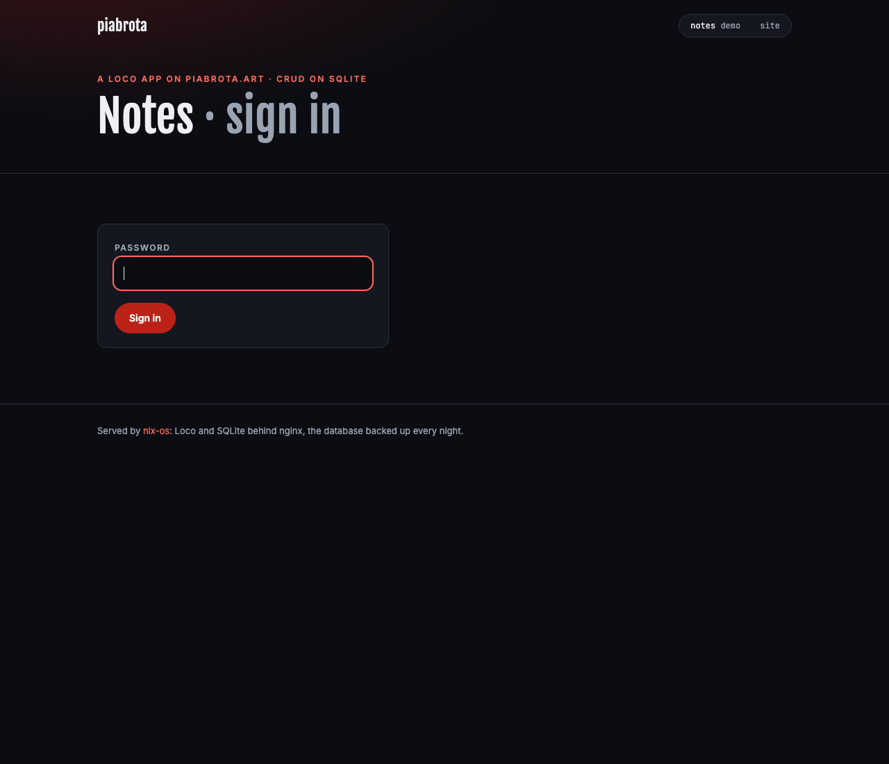
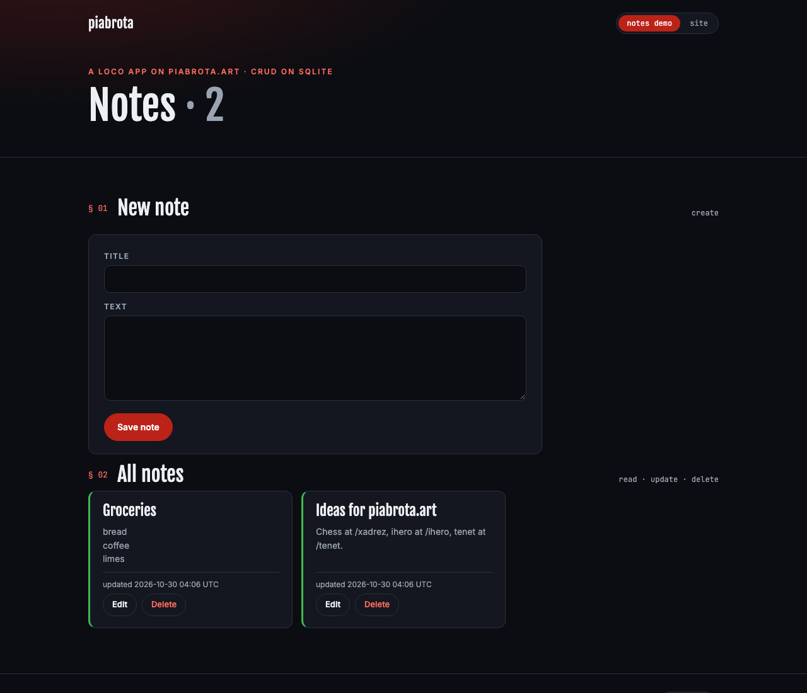
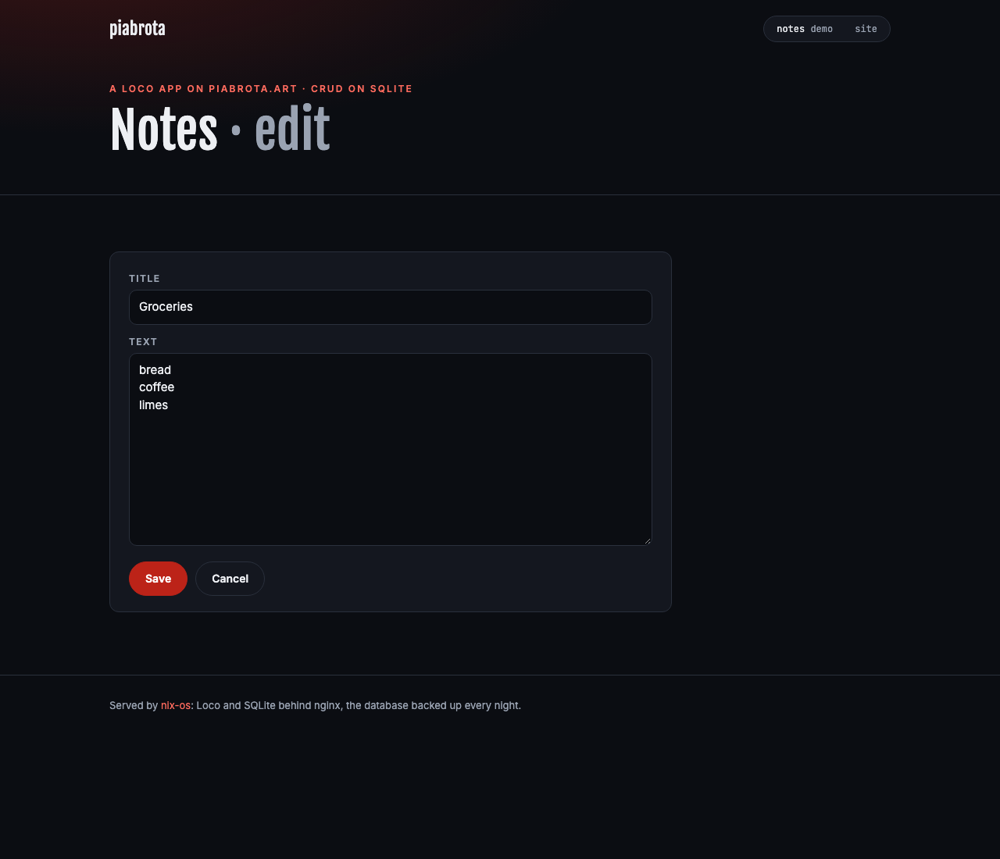

# Loco apps on the VPS

`loco.nix` runs [Loco](https://loco.rs) apps: Rust web apps on SQLite. Each app is a systemd
service behind nginx, with HTTPS from Let's Encrypt and a nightly copy of its database. Until an
app is declared, the module adds nothing to the system.

## What the box gives each app

| Part | What it is |
|---|---|
| Service `loco-<app>` | `<app>-cli start` as the system user `loco-<app>`, `LOCO_ENV=production`, on `127.0.0.1:<port>`; restarts on failure; `MemoryMax=256M` by default; sandboxed (no capabilities, read-only system, private `/tmp` and devices, no new privileges) |
| SQLite | `DATABASE_URL=sqlite:///var/lib/loco-<app>/db.sqlite?mode=rwc`; the state directory is the one place the app can write |
| Backups | `loco-<app>-backup`, daily: `sqlite3 .backup` into `/var/lib/loco-<app>/backup/`, seven days kept |
| nginx | a virtual host per `domain`, HTTP to HTTPS, WebSockets proxied, gzip, no version in headers; or, with `path`, two locations on the site's host (`= /x` and `/x/`), HTTP redirected to HTTPS there too |
| ACME | a Let's Encrypt certificate per domain (lego, renewed by a timer); none for an app on a `path`, which uses the site's |
| Firewall | 80 and 443 open, only once an app exists |
| Variables | `PORT`, `NODE_PORT`, `BINDING`, `HOST`, `DATABASE_URL`, plus `environment`; secrets from `environmentFile` |

No Postgres and no Redis: both are resident daemons that this machine cannot afford. Run
background jobs in the same process: `workers.mode: BackgroundAsync`, or a SQLite queue
(`queue.kind: Sqlite`) with `extraArgs = [ "--server-and-worker" ]`.

The first app adds 83.6 MiB to the closure (lego 66 MiB, OpenSSL 4 for nginx 8.7 MiB, the sqlite
CLI, nginx 2.2 MiB), measured with `dix` on nixos-26.05 `08d3a97` on 2026-10-29. Each later app
adds only its own package.

## Add an app

1. **Package it with Nix in its own repository.** The flake's package must have the binary in
   `bin/` and the files Loco reads beside it in `share/<app>/`:

   ```nix
   packages.x86_64-linux.default = pkgs.rustPlatform.buildRustPackage {
     pname = "myapp";
     version = "0.1.0";
     src = ./.;
     cargoLock.lockFile = ./Cargo.lock;
     doCheck = false; # the tests need a database; run them in the app's own CI
     postInstall = ''
       mkdir -p $out/share/myapp
       cp -r config $out/share/myapp/
       [ -d assets ] && cp -r assets $out/share/myapp/ || true
     '';
   };
   ```

   In `config/production.yaml`, read the port, binding, host and database from the
   environment (`{{ get_env(name="PORT", default="5150") }}` and so on) and keep secrets
   such as the JWT secret as `get_env` too. Check it with `myapp-cli doctor --production`.

2. **Point DNS at the box.** An A record (and AAAA, if any) for the domain must point at the
   VPS before the deploy, or the ACME order fails.

3. **Write the secrets on the box, by hand.** Never in this repository:

   ```console
   sudo install -d -m 700 /var/lib/loco-secrets
   echo "JWT_SECRET=$(openssl rand -hex 32)" | sudo tee /var/lib/loco-secrets/myapp.env
   sudo chmod 600 /var/lib/loco-secrets/myapp.env
   ```

4. **Declare it here**, in a PR. Add the app's flake as an input and the app to a module
   (for example a new `apps.nix` imported by `configuration.nix`):

   ```nix
   # flake.nix
   inputs.myapp = {
     url = "github:piabrota/myapp";
     inputs.nixpkgs.follows = "nixpkgs";
   };
   # outputs = inputs@{ self, nixpkgs, deploy-rs, myapp }: …
   # nixosConfigurations.piabrota = nixpkgs.lib.nixosSystem { specialArgs = { inherit inputs; }; … };
   ```

   ```nix
   # apps.nix
   { inputs, ... }:
   {
     piabrota.loco.apps.myapp = {
       package = inputs.myapp.packages.x86_64-linux.default;
       domain = "myapp.piabrota.art";
       port = 5150;
       environmentFile = "/var/lib/loco-secrets/myapp.env";
     };
   }
   ```

   The merge deploys it. CI builds the app on the runner, so the VPS compiles nothing. A new
   version of the app is a `nix flake update myapp` PR.

## On a path of the site instead of a domain

`path = "/myapp"` (instead of `domain`) mounts the app on the static site's host,
`www.piabrota.art/myapp`: no DNS record, no certificate. nginx passes the path unchanged, so the
app's routes must start with it (in Loco, `Routes::new().prefix("myapp")`), and `HOST` is the
site's address. Plain HTTP to the path is redirected to HTTPS, even though the site itself answers
on both: a password or a session cookie never crosses in clear.

## The notes demo

`apps/notes/` is a sample Loco app, built here (`apps/notes/default.nix`) and declared in
`apps.nix`: CRUD for notes on SQLite at <https://www.piabrota.art/notes>, behind one password. It
was generated with `loco new` 1.2.0 (`--db sqlite --bg async --assets serverside`) and
`cargo loco generate scaffold note title:string! content:text!`; the pages
(`src/controllers/web.rs`, `assets/views/notes/`) are written by hand, server-rendered with Tera, in
the site's stylesheet. The generated JSON API and the account routes are not mounted.

| Sign in | The notes | Edit |
|---|---|---|
|  |  |  |

The password and the cookie secret are on the box, never in this repository:

```console
sudo install -d -m 700 /var/lib/loco-secrets
printf 'NOTES_PASSWORD=%s\nNOTES_SECRET=%s\n' '<the password>' "$(openssl rand -hex 32)" \
  | sudo tee /var/lib/loco-secrets/notes.env >/dev/null
sudo chmod 600 /var/lib/loco-secrets/notes.env
sudo systemctl restart loco-notes
```

Until that file exists the service runs with no password, and then nobody can sign in: the wall
fails shut. Changing `NOTES_SECRET` signs everyone out. Measured in a container on 2026-10-30: the
package is 32.7 MiB (the rest of its closure, glibc and the gcc runtime, is already in the system),
and the running app uses about 24 MiB of RAM; `memoryMax` is 128M.

## The database: growing SQLite, or leaving it

Every app keeps one SQLite file, `/var/lib/loco-<app>/db.sqlite`, and seven nightly copies beside
it. What to do as it grows, and if it ever has to move.

**Schema changes are migrations.** Each table change is a SeaORM migration in the app's
`migration/` crate (`cargo loco generate migration ...`), and the app applies the pending ones when
it starts (`auto_migrate: true` in `config/production.yaml`). Never change a table by hand on the
box: the next deploy would not know about it. A rollback of the system does not undo a migration
that already ran; write migrations that the previous version of the app can live with (add columns,
do not rename or drop them in the same release).

**Size.** SQLite holds databases far larger than this disk (its limit is in terabytes), so the
limit here is the 50 GB disk, shared with the store and the eight copies (the live file and seven
backups). Check it with:

```console
sudo du -sh /var/lib/loco-*/ ; df -h /
sudo sqlite3 /var/lib/loco-<app>/db.sqlite 'PRAGMA page_count; PRAGMA freelist_count; PRAGMA page_size;'
```

- Deleted rows leave free pages; `sudo -u loco-<app> sqlite3 /var/lib/loco-<app>/db.sqlite 'VACUUM;'`
  gives them back (it needs as much free disk as the database, briefly). Run it as the app's user,
  for the same reason as the backup (root-owned `-wal` and `-shm` files).
- Keep big files (uploads, audio) out of the database: put them in a directory beside it and store
  the path in a row.
- If backups grow too large, keep fewer of them (`-mtime +7` in `loco.nix`) or copy them off the
  box.
- The disk itself grows with a bigger Hostinger plan; the root partition resizes itself at boot
  (`autoResize` in `configuration.nix`).

**Moving to another database.** The app talks to the database through SeaORM, which also speaks
PostgreSQL and MySQL, and its migrations are written in Rust, not in SQLite's dialect. A move is:

1. Run the database somewhere else (a managed PostgreSQL, or another box): not on this VPS, where
   a resident database server does not fit (AGENTS.md).
2. Point the app at it: `DATABASE_URL=postgres://...` in its `environmentFile`. The app runs its
   migrations there on start, creating the same tables.
3. Copy the rows: stop the app, export from SQLite and import into the new database (for example
   with [pgloader](https://pgloader.io), which reads SQLite directly), check the counts, start the
   app.
4. Remove the SQLite file and its backup timer only after the new database has its own backups.

Code that uses SQLite-only SQL (raw queries, `PRAGMA`) has to be checked before the move; the
SeaORM queries need no change.

## Look at it on the box

```console
systemctl status loco-myapp
journalctl -u loco-myapp -f
sudo sqlite3 /var/lib/loco-myapp/db.sqlite '.tables'
ls /var/lib/loco-myapp/backup/
```

`checks.loco-example` builds the system with a stand-in app, so a change to `loco.nix` is built in
CI before any real app depends on it.
