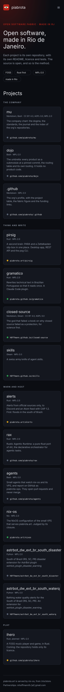
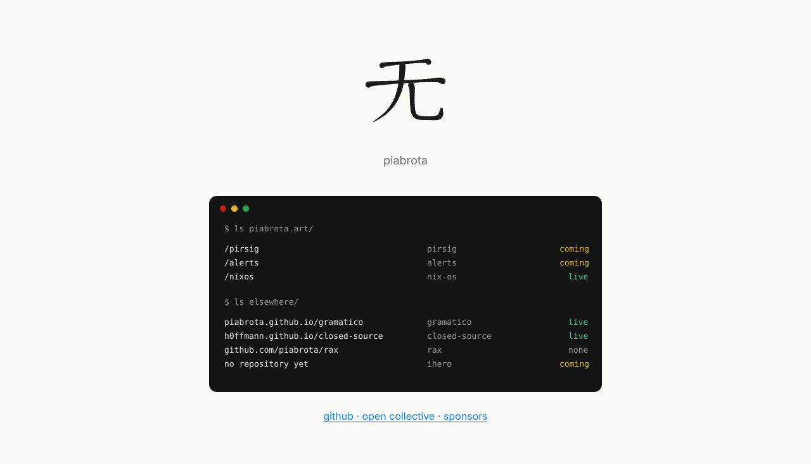
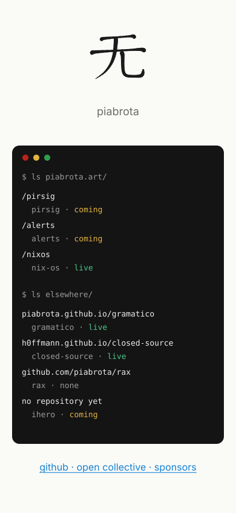

# piabrota.art homepage mockups

[Português](MOCKUPS.ptBR.md) (the first version; this page is its English mirror)

Three directions for the [piabrota.art](https://www.piabrota.art) homepage, each at desktop
(1280 px) and phone (390 px) width. They are SVGs generated in pure Nix (`mockups/`), like the 无
drawing in the README: no drawing program, nothing to install. The facts come from the org
profile ([piabrota/.github](https://github.com/piabrota/.github), `profile/README.md`), copied into
`mockups/data.nix`. They are drafts: the live page stays the one in `site/` until a PR writes the
chosen direction in Gleam.

## A · fabric

The org profile as a page: dark, the logo's red, the projects as cards in the lanes of the "How it
fits" figure (think and write, warn and host, play). Each card says where the project meets the
web, with a green (live), amber (coming) or grey (no site) dot.

| Desktop | Phone |
|---|---|
|  |  |

## B · index

An editorial list: light, a large red PIABROTA wordmark, one numbered row a project, with its
address, state and licence on the right (below, on a phone).

| Desktop | Phone |
|---|---|
|  |  |

## C · paths

Today's page with one more block: 无 and the name stay, and below them comes a listing, like a
terminal, of what answers on piabrota.art and where the rest lives. It is the smallest change.

| Desktop | Phone |
|---|---|
|  |  |

## How to change them

Edit `mockups/data.nix` (the facts) or `mockups/<direction>.nix` (the layout) and run
`just mockups`. It writes the SVGs to `docs/mockups/` and the wiki's copy to `wiki/mockups/`. The
flake's `checks.mockups` fails if the tests (`lib.runTests`) fail or a committed SVG is not the
output of the `.nix` files. None of this enters the VPS's system.
