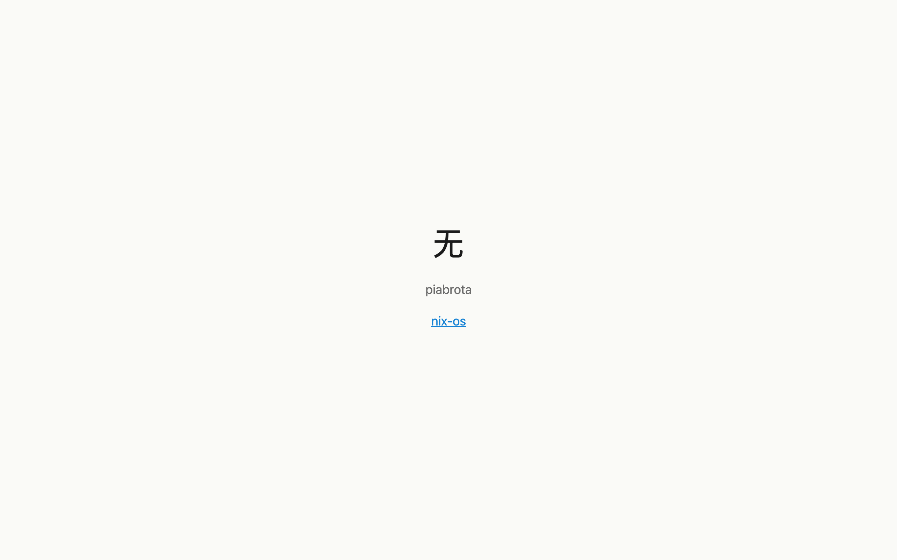
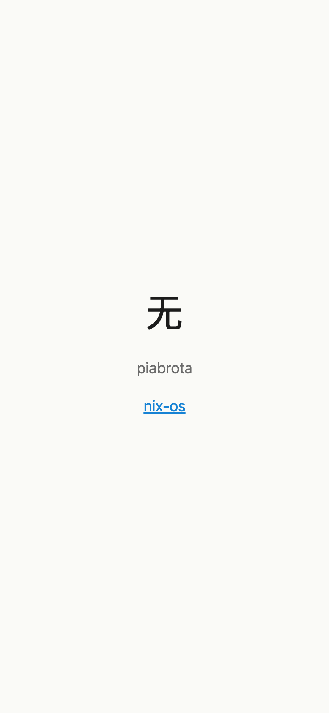
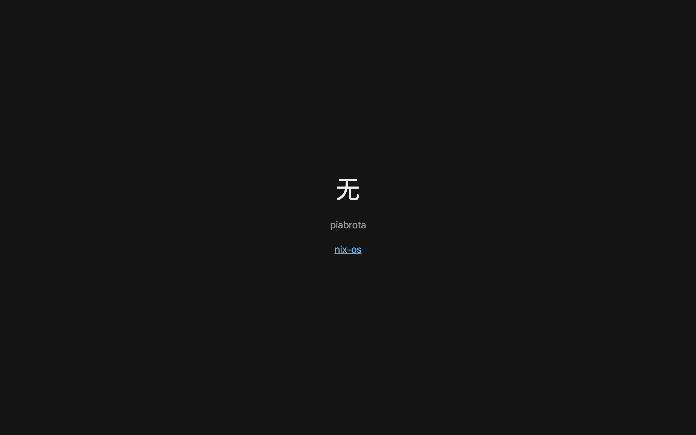
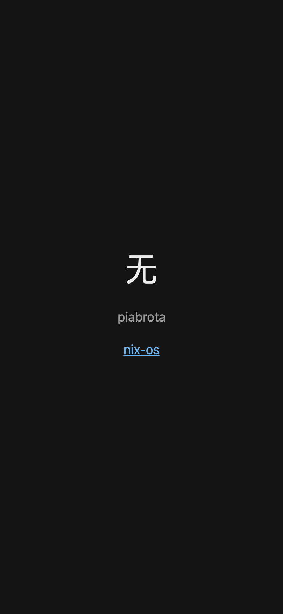

# The static site on www.piabrota.art

`site.nix` serves the files in `site/` on `www.piabrota.art`, over HTTP and HTTPS, through nginx
with a Let's Encrypt certificate. `piabrota.art` answers with a 301 to `www`, keeping the scheme
and the path. `configuration.nix` turns it on (`piabrota.site.enable = true`).

| Desktop | Phone (390 px) |
|---|---|
|  |  |
|  |  |

The page follows the visitor's light or dark setting. To change its design, the agent skills
`frontend-design`, `web-design-guidelines` and `open-pencil` are in `.claude/skills/`
([their README](../.claude/skills/README.md)).

## DNS on Porkbun

Both names must point at the VPS before the site is turned on: on the first switch, Let's Encrypt
checks each one over HTTP. If one does not answer from the VPS, the ACME unit fails, deploy-rs
reports the activation as failed and rolls back. Fix DNS and deploy again.

**Manual, Porkbun** (**Domain Management > piabrota.art > DNS**; ⚠ the menu as Porkbun shows it on
2026-10-29):

1. Delete the parking records Porkbun creates for a new domain: the `ALIAS` on `piabrota.art`
   and the `CNAME` on `*.piabrota.art` (or on `www`), both to `pixie.porkbun.com`. Turn off any
   **URL Forwarding** on the domain.
2. Add two records with the VPS's IPv4 address (the `DEPLOY_HOST` secret; hPanel, **VPS >
   Overview**):

   | Type | Host | Answer | TTL |
   |---|---|---|---|
   | `A` | *(empty, the domain itself)* | `<VPS IPv4>` | 600 |
   | `A` | `www` | `<VPS IPv4>` | 600 |

   Add no `AAAA` record unless the VPS answers on IPv6: Let's Encrypt tries IPv6 first when it
   finds one.
3. Wait until both names resolve to the VPS from outside:

   ```sh
   dig +short piabrota.art A
   dig +short www.piabrota.art A
   ```

Then merge the PR that turns the site on, or run the `deploy` workflow again if it already
failed.

## What answers where

| URL | Answer |
|---|---|
| `http://www.piabrota.art/` | the site |
| `https://www.piabrota.art/` | the site |
| `http://piabrota.art/<path>` | 301 to `http://www.piabrota.art/<path>` |
| `https://piabrota.art/<path>` | 301 to `https://www.piabrota.art/<path>` |
| `…/nixos` | 302 to this repository, so the README link keeps working |

`piabrota.site.httpsOnly = true` turns plain HTTP into a redirect to HTTPS. Add redirects in
`piabrota.site.redirects`, more names in `piabrota.site.redirectFrom`.

## Change the site

Edit the files in `site/` and open a PR. The site is part of the system closure: a merge deploys
it, and a rollback brings the old page back with the old system. Keep it small and static (HTML,
CSS, images): there is no build step and no runtime.

## What it costs

nginx and the ACME client (lego) enter the closure the first time something uses nginx: the site
or a Loco app. Idle nginx uses a few MiB of RAM. Measure with `dix` as `AGENTS.md` asks.
