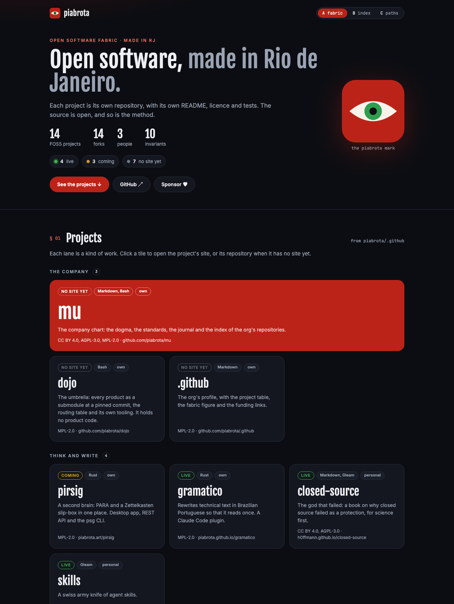
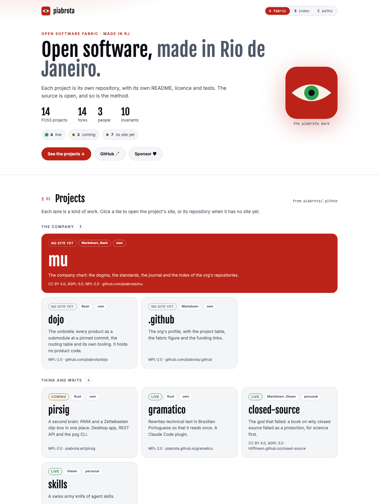
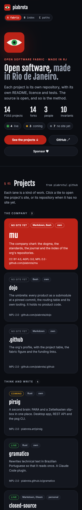
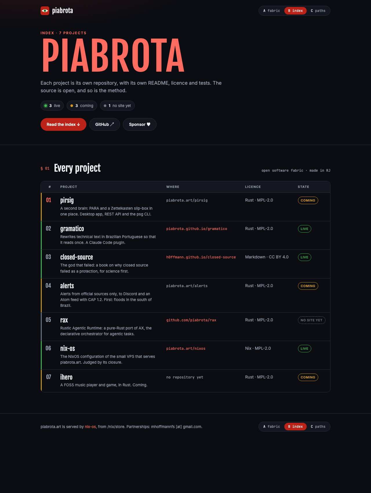
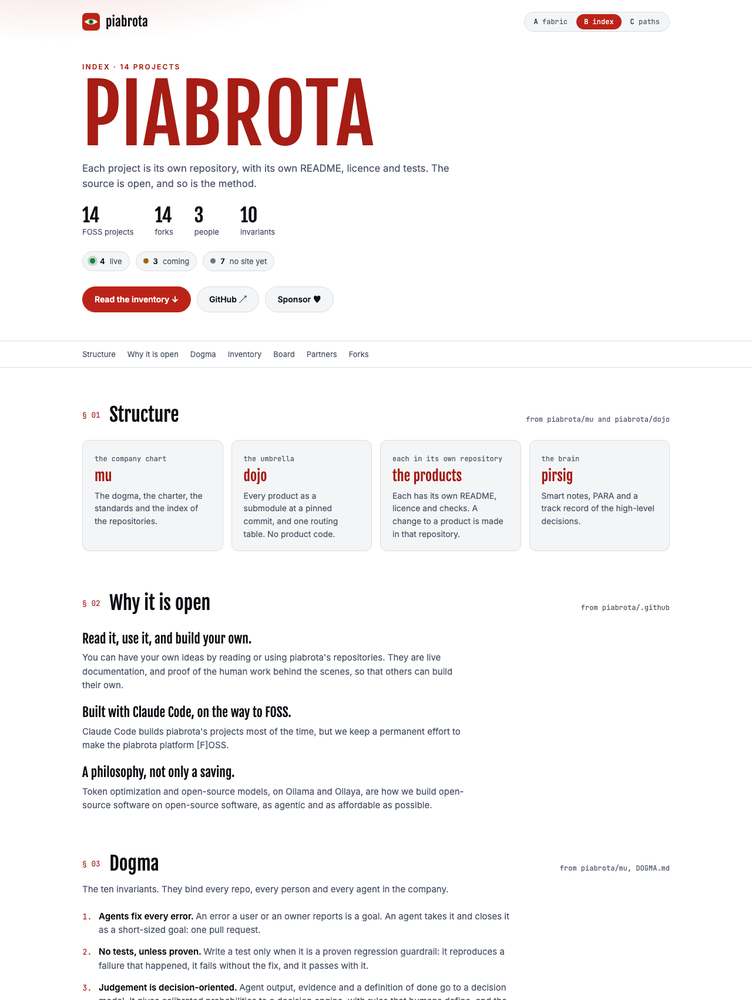
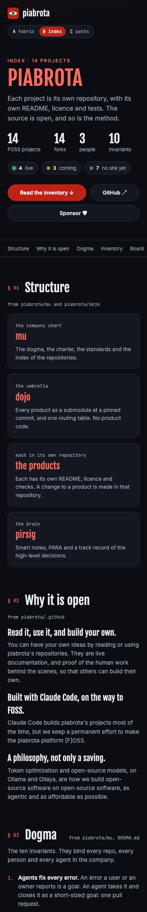
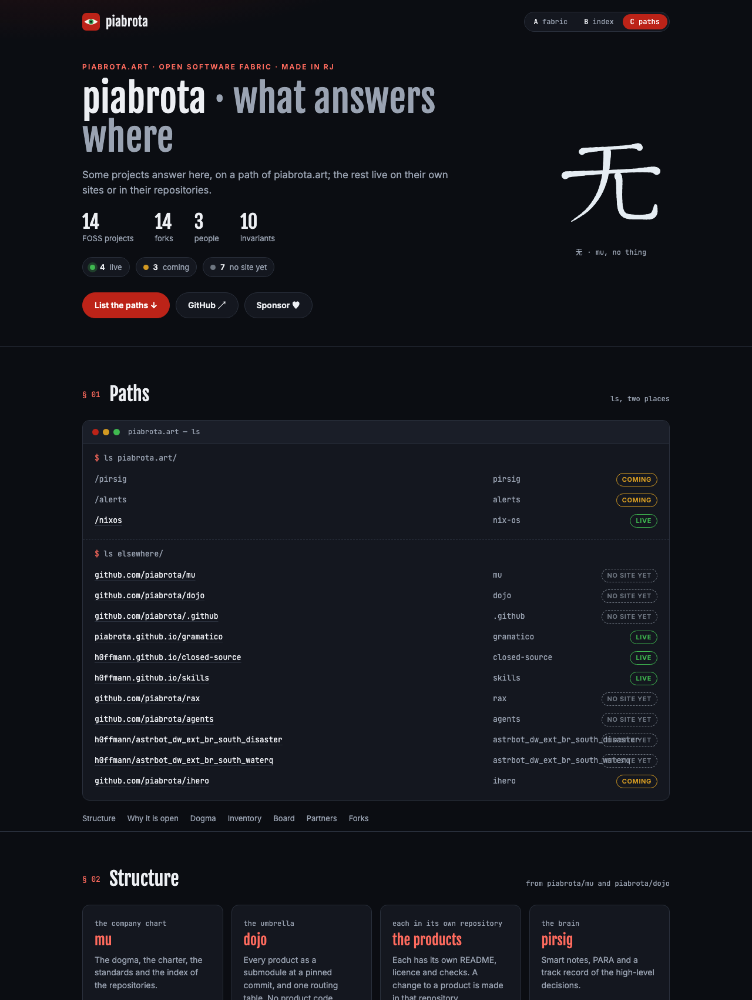
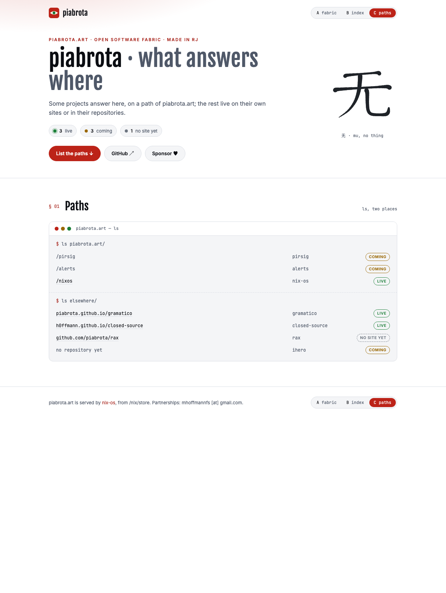
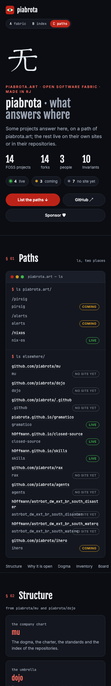
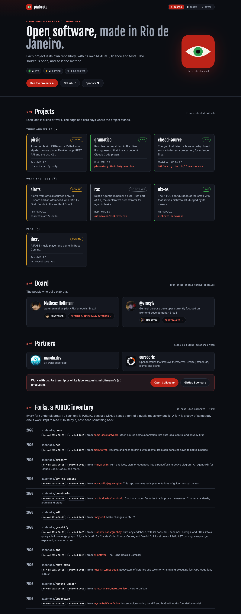

# The static site on www.piabrota.art

`site.nix` serves the site in `site/` (Gleam, prerendered at build time) on `www.piabrota.art`,
over HTTP and HTTPS, through nginx with a Let's Encrypt certificate. `piabrota.art` answers with a
301 to `https://www.piabrota.art`, keeping the path (NixOS's `globalRedirect` points at HTTPS when
the name has a certificate). `hosts/piabrota/default.nix` turns it on (`piabrota.site.enable = true`), on piabrota only.

The site has three designs, grown from the [mockups](MOCKUPS.md), each with a switcher to the
other two:

| Design | Desktop, dark | Desktop, light | Phone (390 px) |
|---|---|---|---|
| A · fabric, at `/` |  |  |  |
| B · index, at `/index/` |  |  |  |
| C · paths, at `/paths/` |  |  |  |

Design A is built as [closed-source's site](https://h0ffmann.github.io/closed-source/) is: numbers in
the hero, tiles with tags, a bar of anchors, then detail in sections. Every design ends with the same
sections: the **structure** (mu, the company chart; dojo, the umbrella; the products; pirsig, the
brain), **why it is open**, the **dogma** (the ten invariants of piabrota/mu), the **FOSS inventory**
(every project with its origin, language, licence, last push and links), the **board** (each person
with a GitHub pill and their website, when they have one), the **partners** (marola.dev and
ouroboric, with their logos) and the **forks**, a PUBLIC inventory of every fork under piabrota, as
h0ffmann/h0ffmann lists its own:



All three wear picasso's look in piabrota's colours, dark first and light when the visitor asks
for it; the rules are [`site/DESIGN.md`](../site/DESIGN.md). The pages load the sister sites'
fonts (Fjalla One, Inter, JetBrains Mono) from Google Fonts, and the avatars and partner logos from
GitHub (`avatars.githubusercontent.com`), so a visit asks Google and GitHub for them; the system
fonts stand in until they load. None of them is stored here. To change a design, the agent skills `frontend-design`,
`web-design-guidelines` and `open-pencil` are in `.claude/skills/`
([their README](../.claude/skills/README.md)), and `site/DESIGN.md` changes in the same PR.

## Analytics

`piabrota.site.analytics.measurementId = "G-…";` (in `hosts/piabrota/default.nix`) adds Google Analytics 4
to every page: Google's tag (`gtag.js`), built into the pages by `site/default.nix`. Empty, the
default, means no analytics and no script at all. The ID is public (it is in every page's source),
so it can be committed. ⚠ Google Analytics sets cookies and sends visits to Google: under the LGPD
the page should say so, and a consent banner may be needed before it loads; neither is in the site
yet.

## DNS on Porkbun

Both names must point at the VPS before the site is turned on: on the first switch, Let's Encrypt
checks each one over HTTP. If one does not answer from the VPS, the ACME unit fails, deploy-rs
reports the activation as failed and rolls back. Fix DNS and deploy again.

**Manual, Porkbun** (**Domain Management > piabrota.art > DNS**; ⚠ the menu as Porkbun shows it on
2026-10-29):

1. Delete the parking records Porkbun creates for a new domain: the `ALIAS` on `piabrota.art`
   and the `CNAME` on `*.piabrota.art` (or on `www`), both to `pixie.porkbun.com`. Turn off any
   **URL Forwarding** on the domain.
2. Add two records with the VPS's IPv4 address (the `DEPLOY_HOST` secret; hPanel, **VPS >
   Overview**):

   | Type | Host | Answer | TTL |
   |---|---|---|---|
   | `A` | *(empty, the domain itself)* | `<VPS IPv4>` | 600 |
   | `A` | `www` | `<VPS IPv4>` | 600 |

   Add no `AAAA` record unless the VPS answers on IPv6: Let's Encrypt tries IPv6 first when it
   finds one.
3. Wait until both names resolve to the VPS from outside:

   ```sh
   dig +short piabrota.art A
   dig +short www.piabrota.art A
   ```

Then merge the PR that turns the site on, or run the `deploy` workflow again if it already
failed.

## What answers where

| URL | Answer |
|---|---|
| `http://www.piabrota.art/` | the site |
| `https://www.piabrota.art/` | the site: design A; B at `/index/`, C at `/paths/`, Hermes's configuration at `/hermes/` |
| `https://www.piabrota.art/skills/` | the skills website, from `skills-site/` |
| `https://www.piabrota.art/figures/` | the figures as interactive pages, from `figures-site/`; `<slug>/` in English, `pt-BR/<slug>/` in pt-BR |
| `…/figures` | 301 to `…/figures/` |
| `…/skills` | 301 to `…/skills/` |
| `http://piabrota.art/<path>` | 301 to `https://www.piabrota.art/<path>` |
| `https://piabrota.art/<path>` | 301 to `https://www.piabrota.art/<path>` |
| `…/nixos` | 302 to this repository, so the README link keeps working |

`piabrota.site.httpsOnly = true` turns plain HTTP into a redirect to HTTPS. Add redirects in
`piabrota.site.redirects`, more names in `piabrota.site.redirectFrom`.

## The icon

Every name under piabrota.art shows the eye as its tab icon. The source is `favicon/favicon.svg`;
`favicon/default.nix` builds it with `resvg`, on the builder only, into `favicon.svg`, `favicon.ico`
(PNGs of 16, 32 and 48 px) and `apple-touch-icon.png` (180 px). The output names no store path.

`favicon.nix` gives each vhost three exact locations for those files, in front of any proxy, with
`Cache-Control: public, max-age=86400`. Every vhost carries them:
`locations = config.piabrota.favicon.locations // { ... };`. Add that term to a new vhost. Basic
auth stays on them.

The pages that we write link the files: the site (`page.gleam`), `skills-site/`, `figures-site/`,
the notes layout, the Hermes docs page and the metrics page (its CSP has `img-src 'self'`). An app
that we do not write names its own icon, so nginx answers for that name as well:

| App | Its own icon | What nginx does |
|---|---|---|
| Hermes dashboard | `/favicon.ico` | serves the eye there |
| The room | `/favicon.svg` (the same eye) | serves the shared file there |
| OpenRig | `data:,` (an empty icon) | `sub_filter` swaps the link in its HTML for the eye; `checks.openrig-icon` fails if a bump changes the literal |

None of the three sets its icon from JavaScript. `checks.favicon` tests the files and that the SVG
equals `parts.eye`.

## The skills website at /skills

`https://www.piabrota.art/skills/` is the website that GitHub Pages served for
[piabrota/skills](https://github.com/piabrota/skills). It moved here.

`skills-site/` holds the Gleam program. It was copied from piabrota/skills, and it is edited here on purpose, for the look.
The look is the one of the site: [`site/DESIGN.md`](../site/DESIGN.md) has its rules.
The program keeps its CSS in `skills-site/src/www.gleam`. It writes the CSS into each page.
Each page has the brand of piabrota, a link back to `www.piabrota.art`, the three sections (skills, agents, awesome-skills) and a foot.
The home page has the install commands as terminal cards, a search box, tags and a card for each skill.
The page loads the same Google Fonts as the site, and its script asks `api.github.com` for the star count.
Change only the look and the page frame. The content, the search, the tags and the copy buttons stay as they were.
No one compiles Gleam on the VPS, and a code change here is not tested there. The build on the builder is the test.

The build reads a pinned commit of piabrota/skills (`rev` and `hash` in `skills-site/default.nix`).
A new commit of that repository shows on the site only after a PR here moves the pin. To move it:

1. Change `rev` to the new commit.
2. Get the hash with `nix-prefetch-url --unpack https://github.com/piabrota/skills/archive/<rev>.tar.gz`.
3. Convert it with `nix hash convert --hash-algo sha256 --to sri <hash>`, and put it in `hash`.

You can also set `hash` to an empty string. The failed build then prints the right one.

Gleam and Erlang run on the CI builder only. The VPS gets the HTML, which is small.
`allowedReferences = [ ]` keeps them out of the VPS closure. The pages use relative links, so
they work under `/skills/`. `piabrota.site.skills = null` removes the page.

To preview, run `just skills-site`. It builds into `./result-skills-site`.

## The figures

`https://www.piabrota.art/figures/` serves each figure of `docs/archify/` as one self-contained
[archify](https://github.com/tt-a1i/archify) page: it zooms, follows the visitor's light or dark
setting, and calls no third party. `/figures/<slug>/` is the English page, `/figures/pt-BR/<slug>/`
the pt-BR mirror, and `/figures/` lists them. The README and the wiki link each figure to its page.

**The index.** `/figures/` has the page frame of `/hosts/`: the brand, the language links, the
design switcher, a hero and the foot, in the site's `style.css`. It shows one card for each figure:
the PNG of `docs/img/` as a preview, the title, the takeaway (the part of `meta.title` after the
first colon), and links to the English page, the pt-BR page and the source in this repository. The
cards' rules (`.figures-grid`, `.figure-card`) are in `site/static/style.css`.

**The bar.** Each figure page has a bar, at most 44 px high, with the brand, `← figures` and a link
to the same figure in the other language. The build puts it after the `<body>` tag. `piabrota.css`
hides everything but the drawing and fits the drawing to the window with `position: fixed`, so the
bar's CSS shows the bar again and moves the drawing down by the bar's height.

`figures-site/default.nix` builds the pages on the builder from the committed JSON
(`docs/archify/*.json`, `docs/archify/pt/*.json`) and `docs/archify/piabrota.css`. For each source it
runs `archify finalize`, as `just figure` does, and fails the build if `validate`, `deliver` or
`check` do not pass. The builder has no Chrome, so archify skips the browser check; `just figure`
runs it. Then it puts the content of `piabrota.css` and the bar's CSS into the page as a `<style>`. It
does not add the Google Fonts link that the PNGs use, so a visit to a figure calls no third party and the system fonts stand in. The index is the one page that does, as the site's other pages do (`site/DESIGN.md`, "Type"); the build fails if another page names Google Fonts.
**No HTML is committed.** A new figure needs its two JSON files and its PNG in `docs/img/` (`just figure`
writes it): the build loops over the sources, and a missing pt-BR mirror or PNG stops it. `allowedReferences = [ ]` keeps node, jq and archify
out of the VPS closure. `piabrota.site.figures = null` removes the page.

**The pin.** `rev` and `hash` in `figures-site/default.nix` name the commit of the submodule
`vendor/archify` (`git ls-files -s vendor/archify`). Move them with the submodule, in the same PR as
`just figure`:

1. Change `rev` to the new commit.
2. Get the hash with `nix-prefetch-url --unpack https://github.com/tt-a1i/archify/archive/<rev>.tar.gz`.
3. Convert it with `nix hash convert --hash-algo sha256 --to sri <hash>`, and put it in `hash`.

**Licences.** archify is MIT (`vendor/archify/LICENSE`). Its pages embed JetBrains Mono, under the SIL
Open Font License 1.1 (`THIRD_PARTY_NOTICES.md` of archify). The index page credits both.

**Size.** The eight pages are about 820 KB each, and `/figures/` is about 6.9 MiB in the VPS
closure (`nix path-info -S`), PNGs included. nginx sends them compressed (`recommendedGzipSettings`). The site sets
no `Content-Security-Policy`, so the pages' inline script and style run as built.


## The structure figure

The Structure section shows the org's fabric figure, drawn by archify in piabrota/.github. It loads from
there at a pinned commit, in English or pt-BR, and no copy lives here. `structure.image` in
`site/locale/<lang>.json` holds the address: change it when the figure changes.

## Closed projects

`closed` in `mockups/data.nix` lists a project that is not FOSS yet. It gets a tile in design A, with no
link. It stays out of the FOSS inventory, the counts and the mockups.

## Languages

Design A has four languages; designs B and C stay in English. English is the source, and it wins when two
texts disagree. `en.json` holds the page's words, and the facts stay in `mockups/data.nix`. Each other file
holds the same words and those facts in its language. A key that one of them lacks stops the build.

| File | Rules |
| --- | --- |
| `pt-BR.json` | gramatico's `cientifico` skill |
| `zh-CN.json` | controlled Simplified Chinese, from `easy-translate`, and simple in the manner of `eli5` |
| `ja-JP.json` | Easy Japanese, from `easy-translate`, and simple in the manner of `eli5` |

Change the source first, then each language. The zh-CN and ja-JP pages keep their banner until a native
reader checks them. A fork's description stays as GitHub publishes it.

## Change the site

The site is Gleam with [Lustre](https://lustre.build), prerendered once at build time, as
[piabrota/gramatico](https://github.com/piabrota/gramatico) builds its site. It has the three
designs of the [mockups](MOCKUPS.md), each a page, with a switcher at the foot of each:

| URL | Design |
|---|---|
| `/` | A · fabric: the org profile as a page, the projects as cards in their lanes |
| `/index/` | B · index: an editorial list, one numbered row a project |
| `/pt-BR/`, `/zh-CN/`, `/ja-JP/` | design A in that language |
| `/paths/` | C · paths: 无 and the name, and a listing of what answers here and where the rest lives |
| `/hermes/` | Hermes Agent as `hermes.nix` configures it, in plain YAML: the hermes card in "think and write" links here ([HERMES.md](HERMES.md#the-hermes-page)) |

The facts (the projects, their blurbs, where each meets the web) come from `mockups/data.nix`, the
same file the mockups draw: the mockups and the site cannot disagree. Change a fact there.

| Path | Is |
|---|---|
| `site/src/piabrota_site/fabric.gleam`, `index.gleam`, `paths.gleam` | the three pages |
| `site/src/piabrota_site/parts.gleam` | what they share: the mark, a project's address, the switcher |
| `site/src/piabrota_site/page.gleam` | the HTML document around each page: head, theme colour, stylesheet |
| `site/src/piabrota_site/render/` | one module a page, which prints it as HTML |
| `site/data.nix` | writes `src/piabrota_site/data.gleam` from `mockups/data.nix`; that file is not committed |
| `site/hermes.nix`, `src/piabrota_site/hermes.gleam` | the /hermes page: `site/hermes.nix` writes `services.hermes-agent` of the evaluated system as YAML, without secrets, and the release tag that `flake.lock` pins (`nodes.hermes-agent.original.ref`); `site.nix` passes it to the build as `piabrota.site.hermes`. The build stops if that tag and `hermesVersion` in `hermes.nix` differ: change both in one pull request |
| `site/test/` | gleeunit tests on the rendered pages |
| `site/static/` | copied as is next to the pages (`style.css`, one body class a design) |
| `site/gleam.toml`, `site/manifest.toml` | the Gleam project and its locked hex packages |
| `site/locale/<lang>.json` | the site's words in each language; `site/data.nix` compiles them, and a key that one language lacks stops the build |
| `site/default.nix` | the build: fetches each hex package at its `manifest.toml` checksum, writes `data.gleam`, checks the format, runs the tests, prerenders the three pages, copies `static/` and the 无 drawing (`docs/drawings/mu.svg`) |
| `site/DESIGN.md` | the look, in rules: tokens, type, shapes, layout, motion |
| `site/design/` | OpenPencil drafts; never built or deployed |

```console
just site-test    # data.gleam, then gleam format and gleam test, in the site dev shell
just site         # the build the VPS gets, into ./result-site
```

After a dependency change (`gleam add`, `gleam update`), commit the new `manifest.toml`: the build
reads every package and checksum from it and runs offline.

Edit the code and open a PR. The site is part of the system closure: a merge deploys it, and a
rollback brings the old page back with the old system.

**What reaches the VPS.** Gleam, node and the hex packages run on the builder (the CI runner)
only. The output is the three pages, the files in `static/` and `mu.svg`, about 27 KiB;
`site/default.nix` sets
`allowedReferences = [ ]`, so the build fails if the output names any store path, and nothing of
the toolchain can enter the system closure. No page loads JavaScript.

## Design with OpenPencil

`.mcp.json` declares OpenPencil's MCP server, `@open-pencil/mcp` pinned to 0.16.0 and started with
`npx` (node from `nix develop .#site`, or your own). It drives the [OpenPencil](https://openpencil.dev)
desktop app, which must be open with a document loaded. `OPENPENCIL_MCP_ROOT` limits its file
access to `site/design/`. Draft or inspect a design there, then change `app.gleam` and
`static/style.css` to match it. The server runs where the agent runs, never on the VPS.

## What it costs

nginx and the ACME client (lego) enter the closure the first time something uses nginx: the site
or a Loco app. Idle nginx uses a few MiB of RAM. Measure with `dix` as `AGENTS.md` asks.
