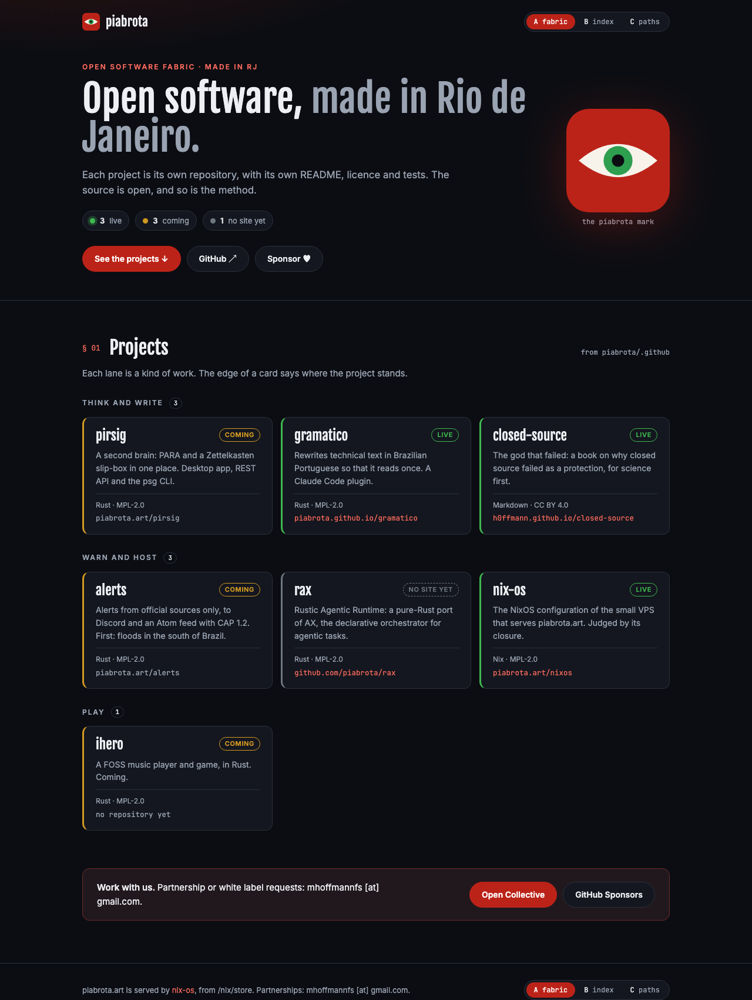
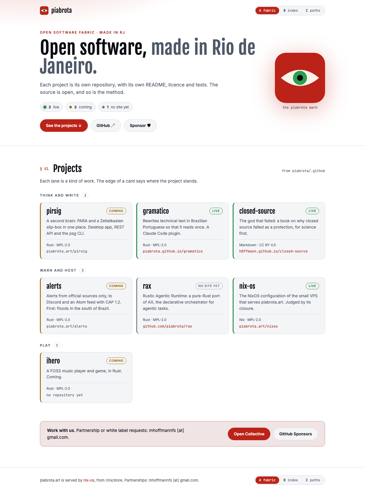
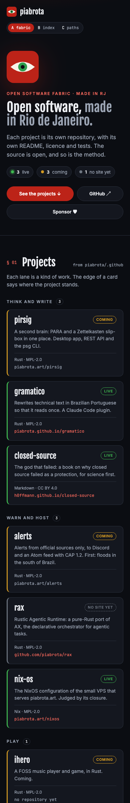
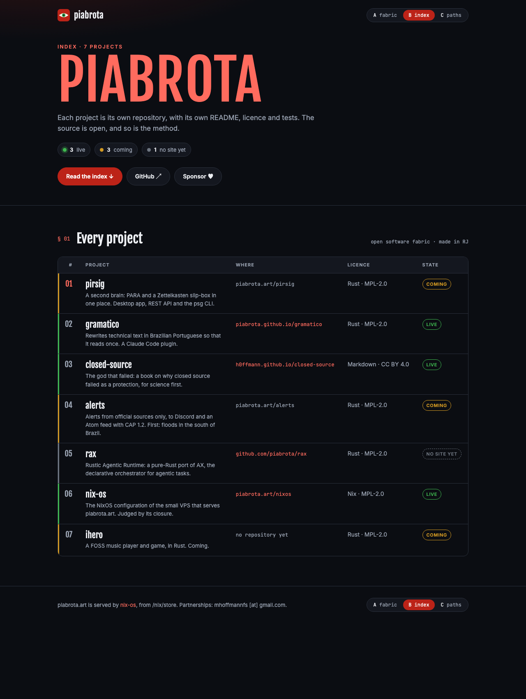
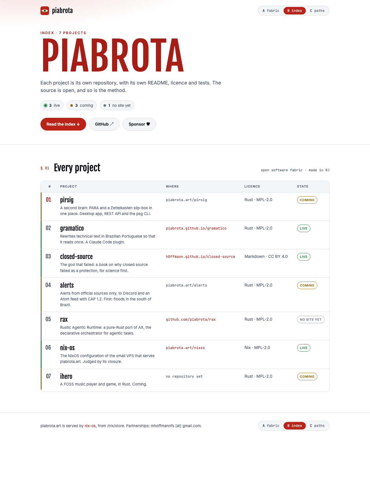
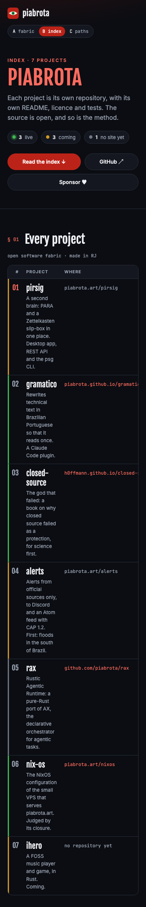
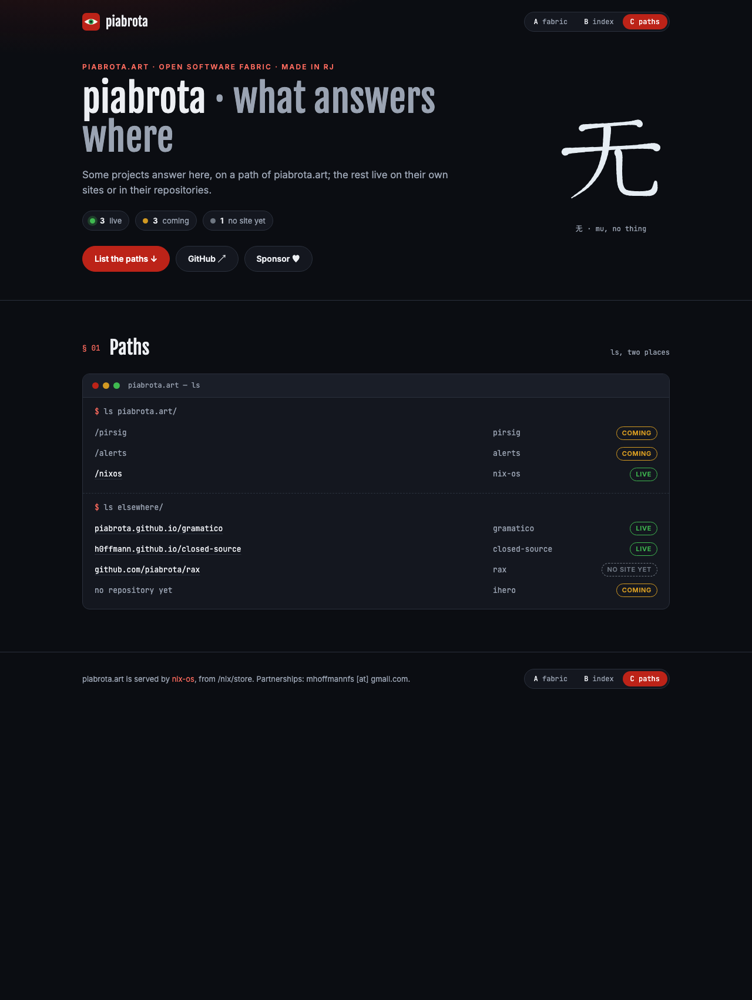
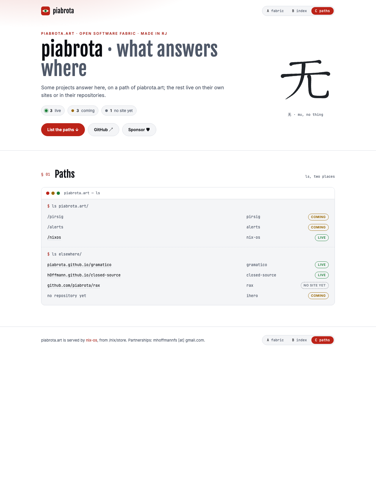
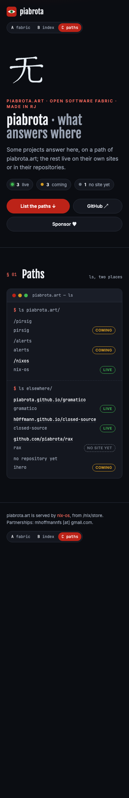

# The static site on www.piabrota.art

`site.nix` serves the site in `site/` (Gleam, prerendered at build time) on `www.piabrota.art`,
over HTTP and HTTPS, through nginx with a Let's Encrypt certificate. `piabrota.art` answers with a
301 to `https://www.piabrota.art`, keeping the path (NixOS's `globalRedirect` points at HTTPS when
the name has a certificate). `configuration.nix` turns it on (`piabrota.site.enable = true`).

The site has three designs, the [mockups](MOCKUPS.md) built for real, each with a switcher to the
other two:

| Design | Desktop, dark | Desktop, light | Phone (390 px) |
|---|---|---|---|
| A · fabric, at `/` |  |  |  |
| B · index, at `/index/` |  |  |  |
| C · paths, at `/paths/` |  |  |  |

All three wear picasso's look in piabrota's colours, dark first and light when the visitor asks
for it; the rules are [`site/DESIGN.md`](../site/DESIGN.md). The pages load the sister sites'
fonts (Fjalla One, Inter, JetBrains Mono) from Google Fonts, so a visit asks Google for them; the
system fonts stand in until they load. To change a design, the agent skills `frontend-design`,
`web-design-guidelines` and `open-pencil` are in `.claude/skills/`
([their README](../.claude/skills/README.md)), and `site/DESIGN.md` changes in the same PR.

## DNS on Porkbun

Both names must point at the VPS before the site is turned on: on the first switch, Let's Encrypt
checks each one over HTTP. If one does not answer from the VPS, the ACME unit fails, deploy-rs
reports the activation as failed and rolls back. Fix DNS and deploy again.

**Manual, Porkbun** (**Domain Management > piabrota.art > DNS**; ⚠ the menu as Porkbun shows it on
2026-10-29):

1. Delete the parking records Porkbun creates for a new domain: the `ALIAS` on `piabrota.art`
   and the `CNAME` on `*.piabrota.art` (or on `www`), both to `pixie.porkbun.com`. Turn off any
   **URL Forwarding** on the domain.
2. Add two records with the VPS's IPv4 address (the `DEPLOY_HOST` secret; hPanel, **VPS >
   Overview**):

   | Type | Host | Answer | TTL |
   |---|---|---|---|
   | `A` | *(empty, the domain itself)* | `<VPS IPv4>` | 600 |
   | `A` | `www` | `<VPS IPv4>` | 600 |

   Add no `AAAA` record unless the VPS answers on IPv6: Let's Encrypt tries IPv6 first when it
   finds one.
3. Wait until both names resolve to the VPS from outside:

   ```sh
   dig +short piabrota.art A
   dig +short www.piabrota.art A
   ```

Then merge the PR that turns the site on, or run the `deploy` workflow again if it already
failed.

## What answers where

| URL | Answer |
|---|---|
| `http://www.piabrota.art/` | the site |
| `https://www.piabrota.art/` | the site: design A; B at `/index/`, C at `/paths/` |
| `http://piabrota.art/<path>` | 301 to `https://www.piabrota.art/<path>` |
| `https://piabrota.art/<path>` | 301 to `https://www.piabrota.art/<path>` |
| `…/nixos` | 302 to this repository, so the README link keeps working |

`piabrota.site.httpsOnly = true` turns plain HTTP into a redirect to HTTPS. Add redirects in
`piabrota.site.redirects`, more names in `piabrota.site.redirectFrom`.

## Change the site

The site is Gleam with [Lustre](https://lustre.build), prerendered once at build time, as
[piabrota/gramatico](https://github.com/piabrota/gramatico) builds its site. It has the three
designs of the [mockups](MOCKUPS.md), each a page, with a switcher at the foot of each:

| URL | Design |
|---|---|
| `/` | A · fabric: the org profile as a page, the projects as cards in their lanes |
| `/index/` | B · index: an editorial list, one numbered row a project |
| `/paths/` | C · paths: 无 and the name, and a listing of what answers here and where the rest lives |

The facts (the projects, their blurbs, where each meets the web) come from `mockups/data.nix`, the
same file the mockups draw: the mockups and the site cannot disagree. Change a fact there.

| Path | Is |
|---|---|
| `site/src/piabrota_site/fabric.gleam`, `index.gleam`, `paths.gleam` | the three pages |
| `site/src/piabrota_site/parts.gleam` | what they share: the mark, a project's address, the switcher |
| `site/src/piabrota_site/page.gleam` | the HTML document around each page: head, theme colour, stylesheet |
| `site/src/piabrota_site/render/` | one module a page, which prints it as HTML |
| `site/data.nix` | writes `src/piabrota_site/data.gleam` from `mockups/data.nix`; that file is not committed |
| `site/test/` | gleeunit tests on the rendered pages |
| `site/static/` | copied as is next to the pages (`style.css`, one body class a design) |
| `site/gleam.toml`, `site/manifest.toml` | the Gleam project and its locked hex packages |
| `site/default.nix` | the build: fetches each hex package at its `manifest.toml` checksum, writes `data.gleam`, checks the format, runs the tests, prerenders the three pages, copies `static/` and the 无 drawing (`docs/drawings/mu.svg`) |
| `site/DESIGN.md` | the look, in rules: tokens, type, shapes, layout, motion |
| `site/design/` | OpenPencil drafts; never built or deployed |

```console
just site-test    # data.gleam, then gleam format and gleam test, in the site dev shell
just site         # the build the VPS gets, into ./result-site
```

After a dependency change (`gleam add`, `gleam update`), commit the new `manifest.toml`: the build
reads every package and checksum from it and runs offline.

Edit the code and open a PR. The site is part of the system closure: a merge deploys it, and a
rollback brings the old page back with the old system.

**What reaches the VPS.** Gleam, node and the hex packages run on the builder (the CI runner)
only. The output is the three pages, the files in `static/` and `mu.svg`, about 27 KiB;
`site/default.nix` sets
`allowedReferences = [ ]`, so the build fails if the output names any store path, and nothing of
the toolchain can enter the system closure. No page loads JavaScript.

## Design with OpenPencil

`.mcp.json` declares OpenPencil's MCP server, `@open-pencil/mcp` pinned to 0.16.0 and started with
`npx` (node from `nix develop .#site`, or your own). It drives the [OpenPencil](https://openpencil.dev)
desktop app, which must be open with a document loaded. `OPENPENCIL_MCP_ROOT` limits its file
access to `site/design/`. Draft or inspect a design there, then change `app.gleam` and
`static/style.css` to match it. The server runs where the agent runs, never on the VPS.

## What it costs

nginx and the ACME client (lego) enter the closure the first time something uses nginx: the site
or a Loco app. Idle nginx uses a few MiB of RAM. Measure with `dix` as `AGENTS.md` asks.
