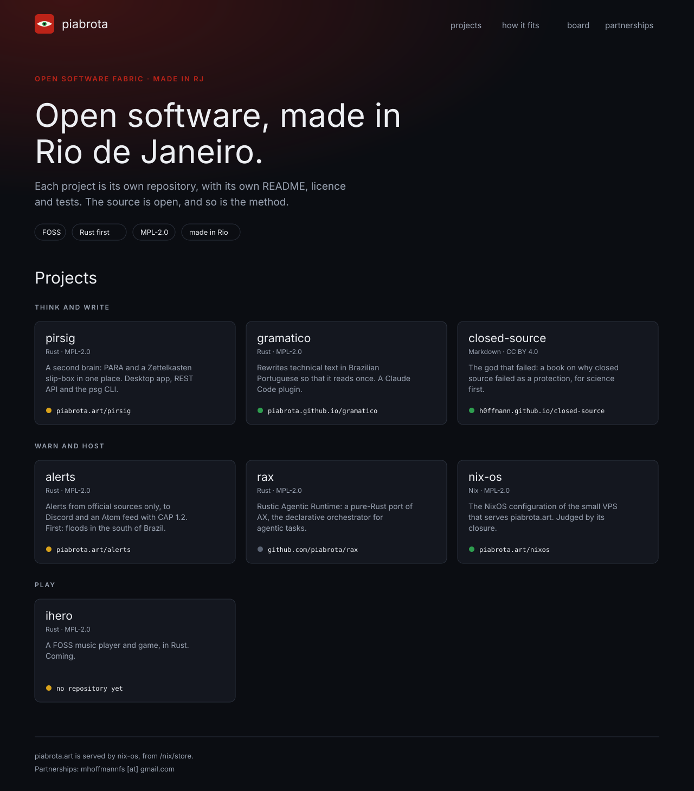
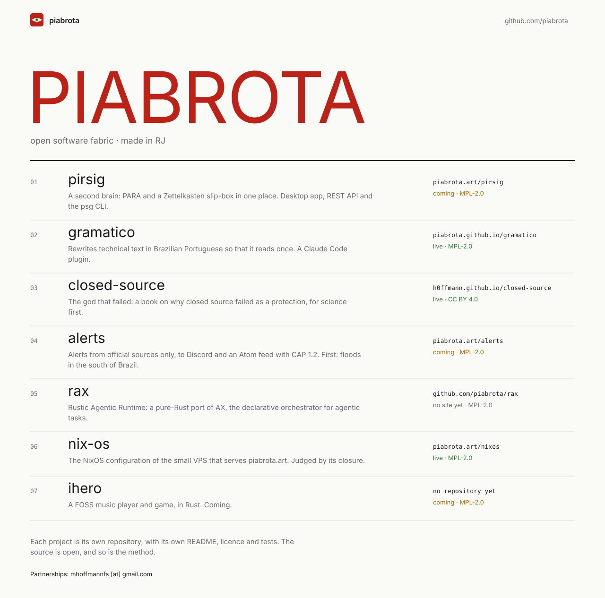
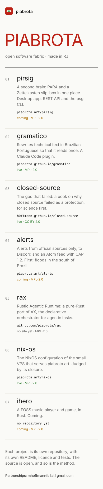

# Maquetes da home de piabrota.art

[English](Mockups)

Três direções para a home de [piabrota.art](https://www.piabrota.art), cada uma em desktop (1280 px)
e celular (390 px). São SVGs gerados em Nix puro (`mockups/`), como o desenho 无 do README: nenhum
programa de desenho, nada para instalar. Os fatos vêm do perfil da org
([piabrota/.github](https://github.com/piabrota/.github), `profile/README.md`), copiados em
`mockups/data.nix`. O site builda as três em Gleam, a partir do mesmo
`mockups/data.nix`: a A em [www.piabrota.art](https://www.piabrota.art/), a B em
[/index/](https://www.piabrota.art/index/), a C em [/paths/](https://www.piabrota.art/paths/).

## A · fabric

O perfil da org como página: escura, o vermelho do logo, os projetos em cartões nas faixas da
figura "How it fits" (pensar e escrever, avisar e hospedar, jogar). Cada cartão diz onde o projeto
encontra a web, com um ponto verde (no ar), amarelo (chegando) ou cinza (sem site).

| Desktop | Celular |
|---|---|
|  |  |

## B · index

Uma lista editorial: clara, a marca PIABROTA grande em vermelho, uma linha numerada por projeto,
com o endereço, o estado e a licença à direita (embaixo, no celular).

| Desktop | Celular |
|---|---|
|  |  |

## C · paths

A página de hoje com um bloco a mais: o 无 e o nome ficam, e embaixo vem uma listagem, como um
terminal, do que responde em piabrota.art e de onde o resto mora. É a menor mudança.

| Desktop | Celular |
|---|---|
|  |  |

## Como mudar

Edite `mockups/data.nix` (os fatos) ou `mockups/<direção>.nix` (o layout) e rode `just mockups`. O
comando escreve os SVGs em `docs/mockups/` e a cópia do wiki em `wiki/mockups/`. O
`checks.mockups` do flake falha se os testes (`lib.runTests`) falharem ou se um SVG commitado não for
a saída dos `.nix`. Nada disto entra no sistema da VPS.
